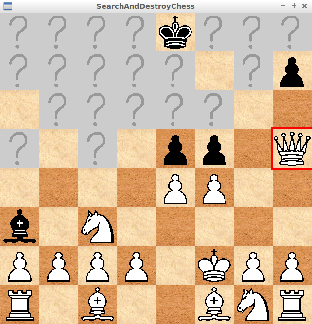

# SearchAndDestroyChess

Chess game with a fog of war, programmed in C++ using SFML
and one of
[Richèl Bilderbeek's games](https://richelbilderbeek.github.io/games).

- [Screenshots](screenshots/README.md)
- [Rules](rules.md)
- [Gameplay](gameplay.md)
- [Controls](controls.md)
- [Strategy](strategy.md)
